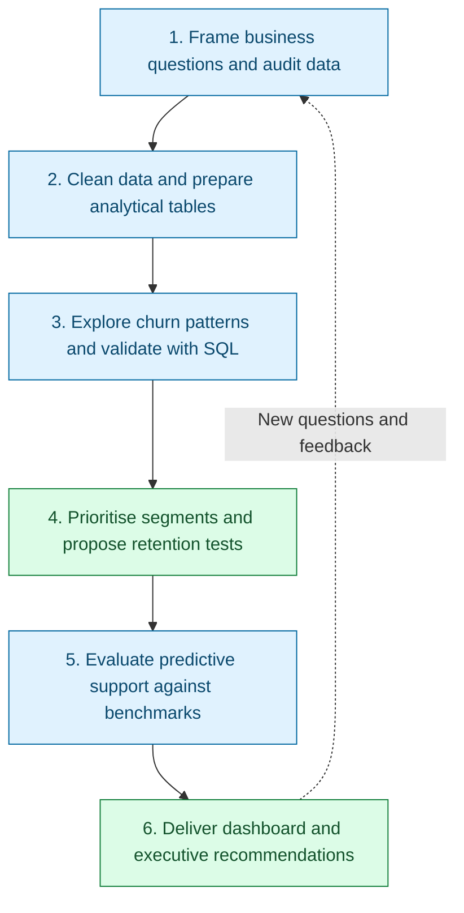
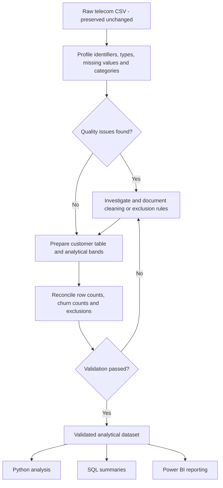
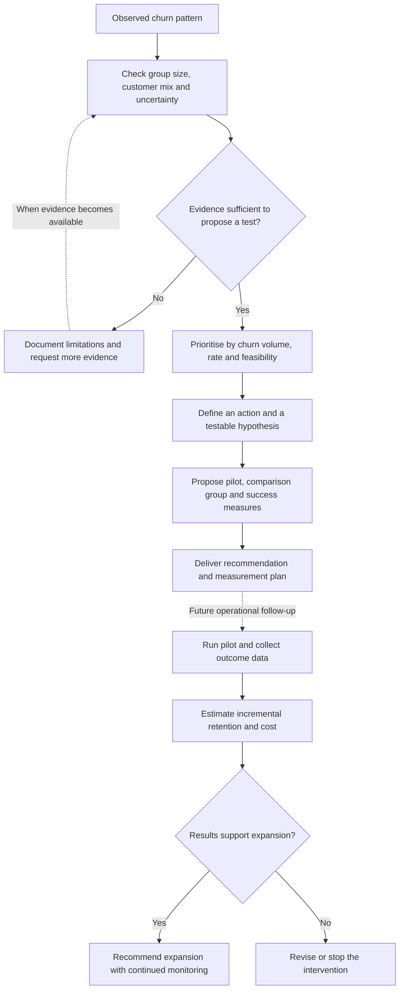

# Customer Churn Analysis & Retention Strategy

A data analyst project that uses telecom customer data to understand churn patterns, identify priority customer segments, and translate findings into practical retention recommendations. A baseline prediction model will support the analysis by testing whether customer characteristics can help prioritise outreach.

> **Project status: Phase 1 complete; ready for Phase 2 preparation.** The analysis brief, executed audit, observed data dictionary, and quality report document 7,043 unique identifiers, 1,869 Yes labels, and 11 whitespace-only `TotalCharges` values. Preparation rules preserve all records and keep unknown totals missing. Source provenance, usage conditions, business definitions, and units remain explicitly unresolved. Phase 2 implementation and later phases remain planned.

## Business objective

Help a retention team decide **which customer segments to investigate first, what actions to test, and how to measure the results**.

The project will answer three connected questions:

1. **What is happening?** How common is churn in this dataset, and where is it concentrated?
2. **What patterns are associated with churn?** How do tenure, contracts, charges, services, and payment methods differ between customers who churn and those who stay?
3. **What should the business do next?** Which segments warrant attention, which retention initiatives are worth testing, and what evidence would be needed to evaluate them?

The intended audience is retention managers, customer experience teams, and business stakeholders. Success means delivering reproducible metrics, clear explanations, and recommendations grounded in evidence. Predictive performance is a supporting objective.

## Business questions and analytical approach

| Business question | Planned analysis | Decision supported |
|---|---|---|
| What proportion of customers have churned? | Customer count, churned customer count, and overall churn rate | Establish the baseline for segment comparisons |
| Which customer groups contribute the most churn? | Compare segment size, churn rate, churn count, and share of all churners | Prioritise segments with meaningful scale and elevated churn |
| Is churn concentrated among newer customers? | Compare documented tenure bands and tenure distributions | Identify where onboarding or early engagement may need investigation |
| How does churn vary by contract type? | Compare contracts overall and within tenure bands | Assess which contract groups warrant targeted retention research |
| Are higher monthly charges associated with churn? | Compare charge distributions and bands within comparable service and contract groups | Investigate pricing or perceived value concerns |
| How do service combinations relate to churn? | Compare internet service, technical support, online security, and other service combinations | Identify service experience hypotheses to investigate |
| Do payment methods and paperless billing show different churn patterns? | Compare billing segments, then check their contract and tenure mix | Assess whether billing experience deserves further investigation |
| Which segments deserve outreach first? | Combine churn rate, customer count, charge exposure, and operational feasibility | Build an evidence-based retention priority list |
| Can a simple model improve outreach prioritisation? | Compare baseline rules and logistic regression at a realistic contact capacity | Assess whether predictive ranking adds value beyond descriptive segmentation |

Demographic fields may be used to describe the customer population and check whether patterns differ across groups. Sensitive characteristics alone will not be used to justify retention targeting.

## Dataset and scope

**Input:** `datasets/TelecomChurnData.csv`

The file contains customer identifiers, customer characteristics, subscription details, billing information, and a `Churn` label. Phase 1 verified one row per observed `customerID` and exact Yes/No coding. Whether each ID represents a person, account, or subscription, as well as the original source and operational churn definition, remains unverified and is documented in the quality report.

| Field group | Examples | Analytical purpose |
|---|---|---|
| Identifier | `customerID` | Validate uniqueness; exclude from predictive features |
| Customer characteristics | `gender`, `SeniorCitizen`, `Partner`, `Dependents` | Describe customer composition and compare patterns |
| Relationship length | `tenure` | Examine churn across stages of the customer relationship |
| Subscription and services | `Contract`, `InternetService`, `TechSupport`, `OnlineSecurity` | Compare contract and service segments |
| Billing and charges | `PaymentMethod`, `PaperlessBilling`, `MonthlyCharges`, `TotalCharges` | Explore billing patterns and financial exposure proxies |
| Outcome | `Churn` | Define the churn indicator used in analysis |

The available columns do not include observation dates, cancellation dates, or retention campaign outcomes. Until supporting documentation is verified, results will describe the supplied dataset rather than monthly churn trends or future churn within a defined period. Tenure groups will be treated as segments, not acquisition cohorts.

## Metric definitions

All metrics will use the validated customer-level dataset. Exclusions and missing outcome labels must be documented before calculating rates.

| Metric | Definition | Interpretation |
|---|---|---|
| Customer count | Number of unique eligible customers with a valid churn label | Denominator for the overall churn rate |
| Churned customers | Eligible customers with `Churn = Yes` | Observed churn volume |
| Overall churn rate | Churned customers / eligible customers | Share labelled as churned in this dataset |
| Segment churn rate | Churned customers in a segment / eligible customers in that segment | Churn prevalence within the group |
| Share of all churners | Churned customers in a segment / all churned customers | Contribution to total churn volume; overlapping segments must not be summed |
| Gap from overall rate | Segment churn rate minus overall churn rate | Difference expressed in percentage points |
| Monthly charge exposure proxy | Sum of `MonthlyCharges` for customers labelled as churned | Descriptive billing amount associated with churners; not verified lost revenue |

Every segment rate will be shown with its customer count and churn count. Groups with fewer than 30 eligible customers will be flagged as small under an analyst-selected reporting convention; this is not a precision guarantee. Phase 3 will include 95% Wilson intervals for key rates and check sensitivity where the convention affects priorities. Missing charge values will be reported alongside financial proxies. See the [quality report](outputs/reports/data_quality_report.md) for the complete denominator and reporting rules.

## Professional analytics pipeline

The flowchart below shows the planned six-phase workflow, from the business question to the stakeholder handoff.



Each phase has a question to answer, a defined output, and a completion criterion. Findings from later phases may require revisiting earlier assumptions.

| Phase | Focus | Primary deliverables | Status |
|---|---|---|---|
| 1 | Business framing and data audit | Analysis brief, data dictionary, quality report | Complete; unresolved source limitations documented |
| 2 | Data cleaning and analytical preparation | Prepared dataset, cleaning log, reproducible preparation steps | Planned |
| 3 | Exploratory analysis and SQL validation | Question-led analysis, charts, reusable SQL queries | Planned |
| 4 | Business interpretation and retention planning | Prioritised segments, recommendation matrix, experiment proposals | Planned |
| 5 | Baseline predictive support | Benchmark comparison, evaluated model pipeline, outreach trade-offs | Planned |
| 6 | Dashboard, reporting, and portfolio delivery | Power BI report, executive summary, reproducible project handoff | Planned |

### Phase 1: Business framing and data audit

**Question:** What decisions should this analysis support, and is the data suitable for answering them?

- Define the intended stakeholder, retention decisions, analytical scope, and business questions.
- Confirm the dataset source, usage conditions, observation context, and meaning of the churn label; record unresolved details explicitly.
- Create a data dictionary covering field descriptions, types, units, category values, and analytical roles.
- Profile row and column counts, unique customer identifiers, duplicate records, missing values, blank strings, category inconsistencies, and numeric conversion failures.
- Inspect `TotalCharges` for blanks or numbers stored as text, and distinguish missing values from valid service states such as `No internet service`.
- Check whether tenure and charges contain implausible values, and investigate records that fail validation before deciding how to handle them.
- Confirm metric definitions and document which questions cannot be answered with the available fields.

**Completed deliverables:** [Analysis brief](outputs/reports/analysis_brief.md), [data dictionary](outputs/reports/data_dictionary.csv), and [quality report](outputs/reports/data_quality_report.md). The quality report contains issues DQ01-DQ07, preparation treatments, metric rules, and Phase 2 acceptance checks. Evidence and open questions are recorded in the [analysis log](outputs/reports/analysis_log.md). Source meanings and units remain provisional; their unresolved status does not imply a failed or incomplete audit.

**Completion criterion:** The data grain, outcome definition, quality issues, and scope limitations are documented, with an explicit treatment or unresolved note for each issue.

### Phase 2: Data cleaning and analytical preparation

**Question:** How can the raw file become a consistent, reproducible dataset for analysis?

**Data quality workflow:** Preserve the source, document treatments, and validate the prepared table before using it across tools.



- Preserve the raw CSV and use the project-relative loading setup already initialised in the notebook.
- Standardise text values and convert numeric columns using explicit rules; log conversion failures and affected row counts.
- Resolve duplicate identifiers after checking whether they represent duplicate records or conflicting customer information.
- Define missing-value handling by field. Avoid replacing unknown charges with zero without supporting evidence.
- Create a binary churn indicator and documented tenure and monthly charge bands. Choose interpretable boundaries and check whether conclusions depend heavily on them.
- Prepare a customer-level analytical table for Python, SQL, and Power BI with consistent column definitions.
- Reconcile customer counts, churn counts, and exclusions before and after cleaning.
- Separate deterministic cleaning for descriptive analysis from model preprocessing: learned imputation, scaling, and encoding belong inside the training pipeline in Phase 5.

**Deliverables:** Cleaned analytical dataset, preparation steps, validation summary, and cleaning decision log in `outputs/`.

**Completion criterion:** Rerunning preparation from the raw file produces the same analytical table, and every excluded or altered record is accounted for.

### Phase 3: Exploratory analysis and SQL validation

**Question:** Where is churn concentrated, and which relationships remain visible after checking customer mix?

- Establish the overall customer count, churn count, churn rate, and class balance.
- Compare churned and retained customers across tenure, monthly charges, contracts, payment methods, and service subscriptions.
- Report both churn rate and churn volume so that small high-rate groups are not automatically treated as the largest business opportunity.
- Examine focused combinations such as contract by tenure, internet service by technical support, and payment method by contract.
- Check whether headline differences persist within comparable groups; describe possible confounding and avoid interpreting associations as causes.
- Use distribution plots for numeric fields and clearly labelled comparison charts for categorical segments. Include denominators and units.
- Write SQL queries in `sql/` for baseline KPIs, segment comparisons, and priority segment tables; document the chosen SQL engine and table-loading steps.
- Reconcile SQL and pandas outputs using identical filters, denominators, null handling, and rounding rules.
- Maintain a question-to-evidence log recording the answer, supporting chart or query, caveat, and potential business implication.

**Deliverables:** Exploratory notebook sections, SQL scripts, chart exports, and a business question findings table.

**Completion criterion:** Each core descriptive question has a reproducible answer or a documented data limitation, and the main SQL and Python metrics agree.

### Phase 4: Business interpretation and retention planning

**Question:** Which findings are actionable, and what should the business test first?

**From evidence to action:** The project will deliver a proposed pilot and measurement plan. Running the pilot and assessing its impact will require additional operational data.



- Rank candidate segments using churn rate, churn count, segment size, charge exposure, and the feasibility of reaching them.
- Account for overlapping segments so that customer opportunities and financial proxies are not double-counted.
- Separate measured observations, possible explanations, and proposed actions. For example, an association between short tenure and churn could motivate testing onboarding support, but does not establish that onboarding caused churn.
- Build a recommendation matrix containing the evidence, target segment, proposed action, suggested owner, success measure, assumptions, and limitations.
- Where useful, model low, base, and high benefit scenarios using explicit assumptions about contact cost, intervention cost, incremental retention, and customer value. Do not present scenario estimates as realised savings.
- Propose a pilot with an eligible population, treatment and comparison groups, follow-up period, primary retention measure, and cost or customer experience guardrails.
- Identify additional data needed to evaluate the pilot, such as contact history, campaign assignment, cancellation dates, and realised revenue or margin.

**Deliverables:** Prioritised retention opportunities, recommendation matrix, and proposed measurement plan.

**Completion criterion:** Every recommendation links to evidence and a measurable test; hypothetical benefits are clearly distinguished from observed findings.

### Phase 5: Baseline predictive support

**Question:** Can a simple model improve the prioritisation of customers for further retention investigation?

- Verify when each feature would be available relative to the churn event. Exclude identifiers and fields that reveal the outcome or would not be available when scoring customers.
- If observation timing cannot be established, describe the model as an exploratory classifier rather than a validated early-warning system.
- Use a reproducible, stratified train/test split; fit preprocessing only on training data through a scikit-learn pipeline.
- Compare a dummy classifier and logistic regression with a simple business segmentation rule from the descriptive analysis.
- Use validation data or cross-validation within the training set to choose features, model settings, and thresholds. Keep the test set untouched until final evaluation.
- Report precision, recall, F1, confusion matrix, and precision-recall performance. Explain what false positives and false negatives mean for the retention team.
- Evaluate precision, recall, and lift among the highest-risk customers at a stated contact capacity, with the same outreach budget used for each comparison.
- Explain threshold trade-offs using explicit outreach cost assumptions. Predicted churn risk does not establish which customers will respond to an intervention.
- Inspect performance across sufficiently sized customer groups and document unstable results or data limitations.

**Deliverables:** Reproducible baseline pipeline, evaluation table, prioritisation comparison, and model limitations summary.

**Completion criterion:** Held-out results establish whether the model adds value over the benchmarks, and its appropriate use is documented even if the improvement is limited.

### Phase 6: Dashboard, reporting, and portfolio delivery

**Question:** Can a stakeholder understand the findings and choose a next step without reading the notebook?

Plan the Power BI report around three pages:

| Page | Content | Stakeholder use |
|---|---|---|
| Executive overview | Customer count, churn count, churn rate, charge exposure proxy, and main takeaways | Understand the scale of the issue |
| Segment analysis | Contract, tenure, payment, and service comparisons with customer volumes and churn rates | Explore where churn is concentrated |
| Retention priorities | Candidate segments, supporting evidence, proposed actions, and assumptions | Select opportunities for further testing |

- Add purposeful slicers and document DAX measures, denominator rules, filter behaviour, and refresh steps.
- Verify dashboard totals and filtered segment values against the validated SQL and Python outputs.
- Use readable labels, consistent colours, and clear chart titles; include definitions for measures that could be misinterpreted.
- Write a concise executive summary covering the business problem, strongest findings, recommended actions, and limitations.
- Export dashboard screenshots and final charts, and update the README with actual findings, artifact links, and completion status.
- Confirm that a new reader can recreate the analysis using the documented environment, execution order, and relative paths.

**Deliverables:** Power BI file, screenshots, executive summary, final findings, and complete reproduction instructions.

**Completion criterion:** Reported metrics reconcile across tools, recommendations are traceable to evidence, and the project can be reproduced from a fresh checkout.

## Tools and responsibilities

| Area | Tools | Role |
|---|---|---|
| Data preparation and analysis | Python, pandas, NumPy | Validate, clean, transform, and analyse customer data |
| Visual exploration | Matplotlib, Seaborn | Explore distributions and communicate segment comparisons |
| Querying | SQL; engine to be documented in Phase 3 | Reproduce KPIs and build reusable segment summaries |
| Business reporting | Power BI | Present validated metrics and retention priorities |
| Predictive support | scikit-learn; planned dependency | Benchmark a simple classification and prioritisation pipeline |
| Development | VS Code, Jupyter, Git, GitHub | Maintain a reproducible analysis and version history |

## Repository structure

The structure below includes completed Phase 1 artifacts. Empty output folders reserve locations for later phases; unverified source semantics and later-phase log templates do not represent validated business findings.

```text
CustomerChurnPrediction/
|-- datasets/
|   `-- TelecomChurnData.csv       # Raw input; preserve unchanged
|-- notebooks/
|   `-- churnprediction.ipynb      # Executed raw-data audit and six phase sections
|-- sql/
|   `-- README.md                 # Query plan; engine and queries pending
|-- dashboard/
|   |-- README.md                 # Power BI page and delivery plan
|   `-- screenshots/              # Reserved for dashboard exports
|-- outputs/
|   |-- data/                     # Generated customer tables; ignored by Git
|   |-- charts/                   # Reviewed chart exports
|   |-- models/                   # Generated model artifacts; ignored by Git
|   `-- reports/
|       |-- analysis_brief.md      # Business scope, questions, and metrics
|       |-- data_dictionary.csv    # Observed profiles; source semantics unverified
|       |-- data_quality_report.md # Issues, preparation rules, and Phase 2 handoff
|       `-- analysis_log.md        # Audit, cleaning, findings, and action templates
|-- requirements.txt              # Current pinned Python dependencies
|-- .gitignore
`-- README.md                     # Project scope, roadmap, and eventual findings
```

## Workflow priorities

Use a notebook-first data science workflow. Keep data loading, auditing, manipulation, cleaning, feature preparation, visualisation, and modelling directly in `notebooks/churnprediction.ipynb`, with Markdown explanations and visible aggregate results. Run cells interactively in VS Code using the project kernel, and keep the notebook reproducible from a fresh kernel by running cells from top to bottom.

Write Python for a reader who has strong software engineering, SQL, business, and planning skills but is new to Python libraries and data engineering. Phase 1 uses 43 focused code cells, each at most 15 lines, with descriptive variables, basic loops, and SQL parallels for unfamiliar pandas operations. Each step has nearby Markdown explaining its purpose and intermediate operations. Prefer clear intermediate steps over dense expressions; keep the analytical checks and business reasoning rigorous.

Keep separate Python scripts to a minimum and use helpers only for a concrete need that cannot be handled clearly in the notebook. Permanent notebook generation or execution/rewrite scripts are not part of this workflow. For agent verification, temporary Python scripts may execute the existing notebook cells and check outputs; delete these scripts when verification is complete instead of controlling the user's computer. Project contributor instructions are recorded in [AGENTS.md](AGENTS.md).

## Current setup and execution

From the repository root in Windows Command Prompt:

```bat
python -m venv .venv
.venv\Scripts\activate
python -m pip install -r requirements.txt
```

Open `notebooks/churnprediction.ipynb` in VS Code, select the `.venv` kernel, and run the cells in order. Launch from the repository root or a directory inside it; the notebook locates the raw CSV using project-relative paths. Current executable cells audit the raw data, verify its checksum, and read the reviewed data dictionary without rewriting it. They do not export files or generate cleaned data. Use **Restart Kernel**, then **Run All**, to check that the notebook works without state left over from earlier interactive runs. Save the notebook to retain the reviewed outputs. No separate Python runner is required.

Use `outputs/reports/analysis_log.md` to record decisions and findings as work progresses. Each notebook phase has a Markdown planning section, so future work can be added without placeholder executable code.

`requirements.txt` records the current pinned Python packages. The existing environment uses Python 3.14.6 and pandas 3.1.1; installation in a fresh environment remains to be verified. SQL engine setup, Power BI refresh instructions, and model dependencies will be documented when those phases are implemented.

## Planned findings format

No validated business findings are published yet. Completed analysis will use the following structure so that each conclusion answers a business question:

| Business question | Measured finding | Evidence | Business implication | Limitation or next step |
|---|---|---|---|---|
| To be completed after validation | Include the metric, comparison, and customer counts | Link to a chart, query, or notebook section | Explain the decision the finding supports | State uncertainty or the follow-up test needed |

## Limitations and interpretation

- Dataset provenance, collection period, and the churn observation window still need verification.
- Snapshot associations cannot establish why customers left or demonstrate that a proposed intervention will work.
- The supplied fields do not support reliable time trends, acquisition cohort tracking, or campaign impact measurement without additional data.
- Charge totals are billing proxies. Profitability, customer lifetime value, and realised revenue loss require additional business information.
- Small or overlapping segments, missing data, and differences in customer mix can distort comparisons and will be documented.
- Model quality on this dataset alone does not establish future performance or operational readiness.

## Author

Nimisha Upman
